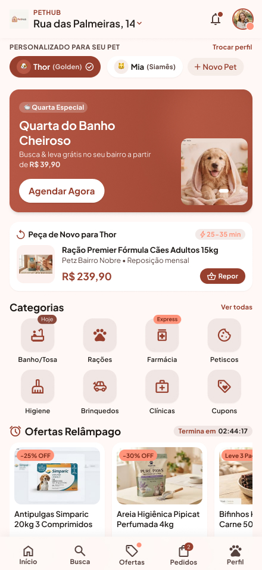
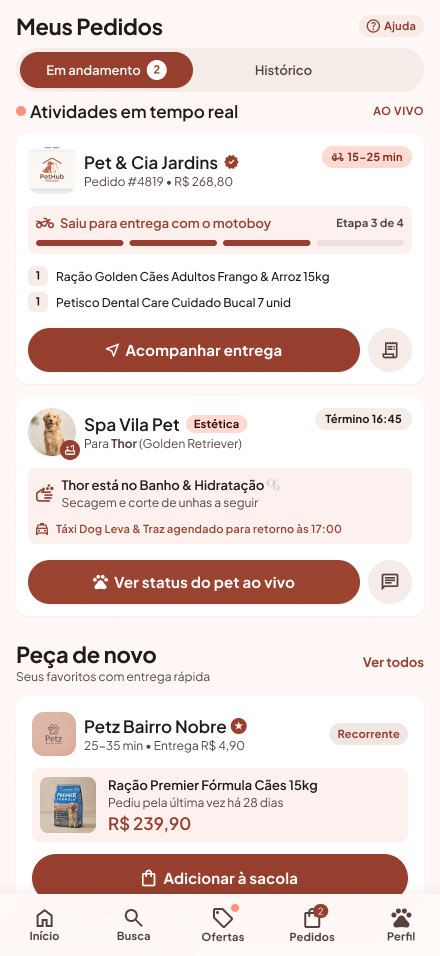
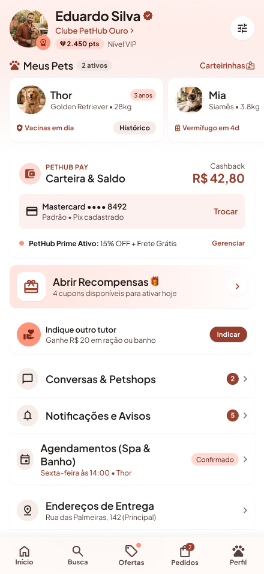
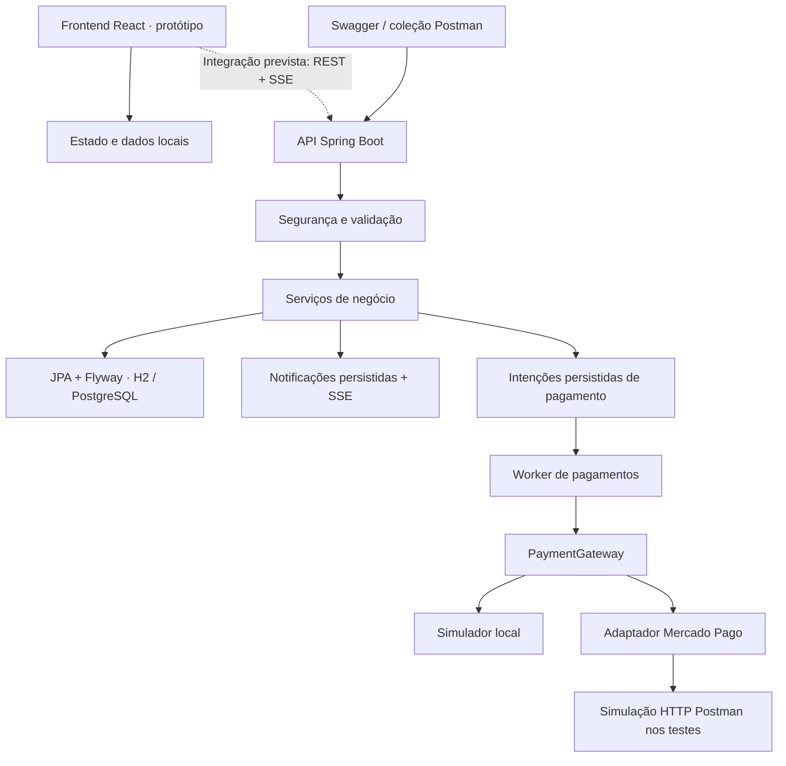

<div align="center">

# 🐾 PetHub

### Marketplace local para conectar tutores, pet shops e serviços de banho e tosa

Produtos e cuidados para o pet em uma mesma jornada: descoberta, compra, agendamento e retirada.


[O projeto](#o-projeto) · [Interface](#interface) · [Engenharia](#decisões-de-engenharia) · [Executar](#como-executar) · [Testes](#testes-e-evidências)

</div>

## O projeto

Encontrar um produto, confirmar o estoque e agendar um banho costuma exigir contatos separados com o estabelecimento. O **PetHub** reúne essas etapas em um marketplace local, no qual o tutor pode comprar produtos e reservar serviços na mesma comanda, enquanto o lojista administra catálogo, capacidade de atendimento e execução dos pedidos.

O projeto nasceu de um trabalho acadêmico de concepção de negócio e modelagem de processos BPMN. A implementação transforma esses processos em regras executáveis, com foco em **backend Java, consistência de dados, segurança e integração de pagamentos**.

### Para conhecer o projeto em poucos minutos

- **Problema de negócio:** coordenar estoque, agenda e pagamento em pedidos que combinam produtos e serviços.
- **Engenharia aplicada:** transações, locks pessimistas, idempotência, controle de acesso e recuperação de falhas de comunicação.
- **Evidências:** 27 testes Java executados, além de uma coleção Postman com 19 requisições e 31 asserções. Os resultados e seus limites estão [documentados](backend/docs/validacao.md).
- **Rastreabilidade:** [matriz que relaciona os requisitos à implementação e à validação](backend/docs/rastreabilidade.md).

> **Estado atual:** o backend pode ser executado e testado localmente. O frontend é um protótipo navegável com estado e dados simulados, cuja integração com a API ainda está pendente. O adaptador Mercado Pago foi exercitado contra uma simulação HTTP; a homologação com o provedor permanece como próxima etapa.

## Interface

O conceito visual prioriza o uso no celular, com navegação entre descoberta de lojas, pedidos e perfil do pet.

<table>
  <tr>
    <th>Início</th>
    <th>Pedidos</th>
    <th>Perfil</th>
  </tr>
  <tr>
    <td></td>
    <td></td>
    <td></td>
  </tr>
</table>

*Imagens dos protótipos visuais. Elas representam a proposta de interface; não comprovam integração das telas com o backend.*

## Funcionalidades do backend

| Perfil | Recursos |
| --- | --- |
| **Tutor** | Cadastro e autenticação, gestão de pets, consulta de lojas por proximidade, compra de produtos, agendamento, acompanhamento de pedidos, aprovação de adicionais e avaliação após conclusão. |
| **Lojista** | Cadastro da loja, gestão de produtos e serviços, estoque, baias por porte, horários de atendimento, aceite e recusa de pedidos, triagem, execução do banho/tosa e histórico comportamental. |
| **Administrador** | Credenciamento de lojas, consulta de pagamentos com problemas e conciliação de transações com o provedor. |

### Regras que orientam a operação

| Situação | Comportamento implementado |
| --- | --- |
| Agendamento de estética | Exige pelo menos **2 horas de antecedência** e capacidade disponível durante toda a duração do serviço. |
| Recebimento de pedido | O lojista tem **15 minutos** para aceitar ou recusar. O vencimento cancela o pedido e libera as reservas. |
| Compra de produtos com banho/tosa | A comanda mantém os produtos reservados para retirada junto com o pet, sem frete de produtos. |
| Ausência do tutor | Após a tolerância de **15 minutos**, o no-show cancela a comanda, libera estoque/agenda e retém **20% somente do serviço**. |
| Serviço adicional | Depende de autorização do tutor, disponibilidade e confirmação do pagamento antes de ser aprovado. |
| Triagem sanitária | Dermatite severa no histórico ou suspeita de ectoparasitas impede o banho comum até atender às condições do serviço terapêutico. |
| Comissão do marketplace | Calcula **10% para a plataforma** e **90% para o lojista**, antes das taxas do provedor. |
| Avaliação | Permite uma avaliação de **1 a 5 estrelas**, por pedido, somente após a conclusão. |

As escolhas feitas para resolver lacunas dos requisitos, incluindo cancelamento de pedidos mistos e previsões financeiras, estão no [contrato e decisões de implementação](backend/docs/contrato.md).

## Decisões de engenharia

| Desafio | Solução adotada | Motivo e limite |
| --- | --- | --- |
| Dois clientes disputando o último produto ou horário | Transações e lock pessimista por loja. | Protege estoque e agenda de reservas conflitantes. A escolha serializa as escritas de cada loja, um custo explícito para este MVP. |
| Checkout enviado novamente após uma falha de rede | Chave de idempotência e verificação do conteúdo da requisição. | A repetição do mesmo pedido recupera o resultado; reutilizar a chave com outro conteúdo gera conflito. |
| Provedor recebe a cobrança, mas a resposta se perde | Intenção de pagamento persistida, worker com retentativas e chaves idempotentes no gateway. | Permite recuperar o resultado sem criar outra cobrança. Casos ambíguos prolongados seguem para conciliação manual. |
| Preços e comissão sujeitos a manipulação ou arredondamento | Valores calculados no servidor com `BigDecimal`. | O cliente informa IDs e quantidades; o backend consulta os preços e mantém consistência entre cobranças e comissão. |
| Acesso indevido a pets, lojas e pedidos | Spring Security, perfis e validação de propriedade dos recursos. | Restringe ações por papel e pelo vínculo do usuário com o recurso. Não existe cadastro público de administrador. |
| Credenciais e notificações de pagamento | OAuth com PKCE, tokens do vendedor cifrados com AES-256-GCM e webhooks com HMAC. | Protege credenciais persistidas e valida a origem do evento; o status financeiro é consultado no provedor. |
| Perda de notificações durante desconexão | Eventos persistidos e Server-Sent Events (SSE), com cursor e replay. | O consumidor pode recuperar eventos ao reconectar. A ligação desse fluxo às telas ainda está pendente. |
| Evolução do banco entre versões | Migrações Flyway e validação de esquema pelo Hibernate. | Mantém as alterações de estrutura versionadas junto ao código. |

**Autenticação:** senhas com BCrypt e sessões Bearer com tokens opacos, revogáveis e com expiração. O banco armazena o hash do token de sessão. Dados brutos de cartão, como número e CVV, não fazem parte do contrato do backend.

### Arquitetura

O backend é uma aplicação Spring Boot única, organizada em pacotes por responsabilidade: `controller`, `service`, `domain`, `dto`, `repository`, `security`, `config`, `exception`, `bootstrap`, `scheduler`, `payment` e `integration.mercadopago`. Veja o [mapa de pacotes](backend/README.md#organização-dos-pacotes) para localizar cada componente.



O perfil local utiliza H2 persistente e pagamentos simulados. PostgreSQL, Docker e o adaptador Mercado Pago estão configurados no projeto; a validação registrada foi realizada com H2 e simulação do provedor.

## Tecnologias

| Camada | Tecnologias |
| --- | --- |
| Backend | Java 21, Spring Boot 4.0.9, Spring MVC, Spring Security, Bean Validation |
| Persistência | JPA/Hibernate, Flyway, H2 e configuração para PostgreSQL |
| Frontend | React 19, TypeScript 5.7, Vite 6, Tailwind CSS 4, React Router |
| Integração | REST, SSE, OAuth, adaptador Mercado Pago para PIX/cartão e comissão via `application_fee` |
| Testes e contrato | JUnit, Spring Boot Test, Spring Security Test, OpenAPI 3.1, Postman |
| Build e execução | Maven Wrapper, npm, Dockerfile e Docker Compose |

## Como executar

### Pré-requisitos

- **JDK 21 ou superior** no `PATH`. A validação registrada utilizou Java 25, compilando para Java 21.
- **Node.js 22+ e npm** para o frontend.
- **Git** para clonar o projeto.

Não é necessário instalar Maven separadamente: o repositório inclui o Wrapper. O primeiro uso precisa de conexão à internet para baixar as dependências.

```bash
git clone https://github.com/eduardoaguiarc/Pethub-Marketplace-Local-Pet.git
cd Pethub-Marketplace-Local-Pet
```

### 1. Iniciar o backend

No PowerShell, a partir da raiz do repositório:

```powershell
cd backend
.\mvnw.cmd spring-boot:run
```

No Linux/macOS, use `sh mvnw spring-boot:run` dentro de `backend`.

| Recurso | Endereço local |
| --- | --- |
| Swagger UI — explorar e testar a API | http://localhost:8080/swagger-ui/index.html |
| API REST | http://localhost:8080/api/v1 |
| Contrato OpenAPI | http://localhost:8080/v3/api-docs |
| Health check | http://localhost:8080/actuator/health |

O perfil padrão `local` funciona sem credenciais Mercado Pago e guarda os dados em `backend/data/`. **Os pagamentos desse perfil são fictícios e não movimentam dinheiro.**

Para testar o fluxo completo de uma loja, configure a conta administrativa, cadastre o lojista e credencie a loja conforme o [guia do backend](backend/README.md#administrador-e-credenciamento). Não há senha administrativa fixa no projeto.

### 2. Iniciar o frontend

Abra outro terminal na raiz do repositório:

```powershell
cd frontend
npm.cmd ci
npm.cmd run dev
```

No Linux/macOS, use `npm ci` e `npm run dev`.

Acesse **http://localhost:5173** para navegar no protótipo. Neste estágio, as ações das telas usam estado local; iniciar os dois processos ainda não conecta automaticamente os fluxos do frontend à API.

Configurações de ambiente, Docker Compose, autenticação, SSE e Mercado Pago estão detalhadas no [README do backend](backend/README.md).

## Testes e evidências

Resultados registrados em **31/10/2026**, com H2 em modo PostgreSQL e migrações aplicadas:

| Verificação | Resultado registrado |
| --- | --- |
| [Regras de negócio e concorrência](backend/src/test/java/br/com/pethub/integration/BusinessRulesTest.java) | 18 testes aprovados |
| [Segurança HTTP e contrato](backend/src/test/java/br/com/pethub/integration/HttpSecurityTest.java) | 3 testes aprovados |
| [Integração com provedor simulado](backend/src/test/java/br/com/pethub/integration/MercadoPagoSimulationTest.java) | 6 testes aprovados |
| [Coleção HTTP Postman](postman/collections/pethub-smoke) | 19 requisições, 31 asserções e zero falhas |
| Build Maven `verify` | Concluído, com geração do JAR executável |
| Notificações SSE | Recebimento de evento, cursor e replay verificados com a aplicação iniciada |

Os cenários incluem disputa concorrente por estoque e baia, timeout de aceite, no-show, autorização de adicionais, revogação de sessão, cobrança com resposta perdida e indisponibilidade de estorno.

Para executar a suíte local, dentro de `backend`:

```powershell
.\mvnw.cmd test
```

Esse comando executa os **21 testes locais**. Os **6 testes de integração simulada** são ignorados quando `MP_SIMULATION_URL` não está configurada. As instruções para iniciar a simulação e executar a coleção estão no [guia de testes do backend](backend/README.md#testes-e-artefatos-de-api).

O [relatório de validação](backend/docs/validacao.md) detalha o alcance das verificações. Testes contra a simulação não comprovam liquidação bancária, repasse ou compatibilidade homologada com uma conta real do Mercado Pago.

## Navegue pelo código

```text
├── backend/
│   ├── src/main/java/br/com/pethub/    # API, regras, segurança e pagamentos
│   ├── src/main/resources/            # Perfis e migrações Flyway
│   ├── src/test/                      # Regras, concorrência e integrações
│   ├── docs/                          # Contrato, requisitos e validação
│   ├── Dockerfile
│   └── compose.yml
├── frontend/
│   └── src/                           # Telas, componentes e estado do protótipo
├── postman/
│   ├── specs/                         # Contrato OpenAPI exportado
│   ├── collections/                   # Fluxo HTTP de verificação
│   ├── mocks/                         # Comportamentos simulados do provedor
│   └── simulations/                   # Cenários de integração
└── prototipo_aplicativo_pethub/        # Referências visuais
```

**Sugestões de leitura:** [OrderService](backend/src/main/java/br/com/pethub/service/OrderService.java) para as regras de pedido e reserva; [PaymentWorker](backend/src/main/java/br/com/pethub/payment/PaymentWorker.java) para o processamento financeiro; [MercadoPagoGateway](backend/src/main/java/br/com/pethub/integration/mercadopago/MercadoPagoGateway.java) para o adaptador externo; e [BusinessRulesTest](backend/src/test/java/br/com/pethub/integration/BusinessRulesTest.java) para exemplos verificáveis do comportamento esperado.

## Próximas etapas

- [ ] Conectar as telas ao contrato da API e substituir o estado simulado dos fluxos de negócio.
- [ ] Integrar notificações SSE, contagem regressiva e alertas do lojista aos eventos reais do backend.- [ ] Concluir as telas de OAuth e tokenização de cartão e homologar o Mercado Pago em conta de teste.
- [ ] Validar PostgreSQL e execução em containers com testes de integração.
- [ ] Automatizar build e testes em integração contínua.
- [ ] Publicar um ambiente de demonstração com dados de exemplo.

As previsões financeiras D+7/D+1 e antecipação representam registros internos; sua execução bancária depende do provedor e de homologação comercial. Os limites e as configurações estão descritos na [documentação da integração](backend/README.md#mercado-pago).
